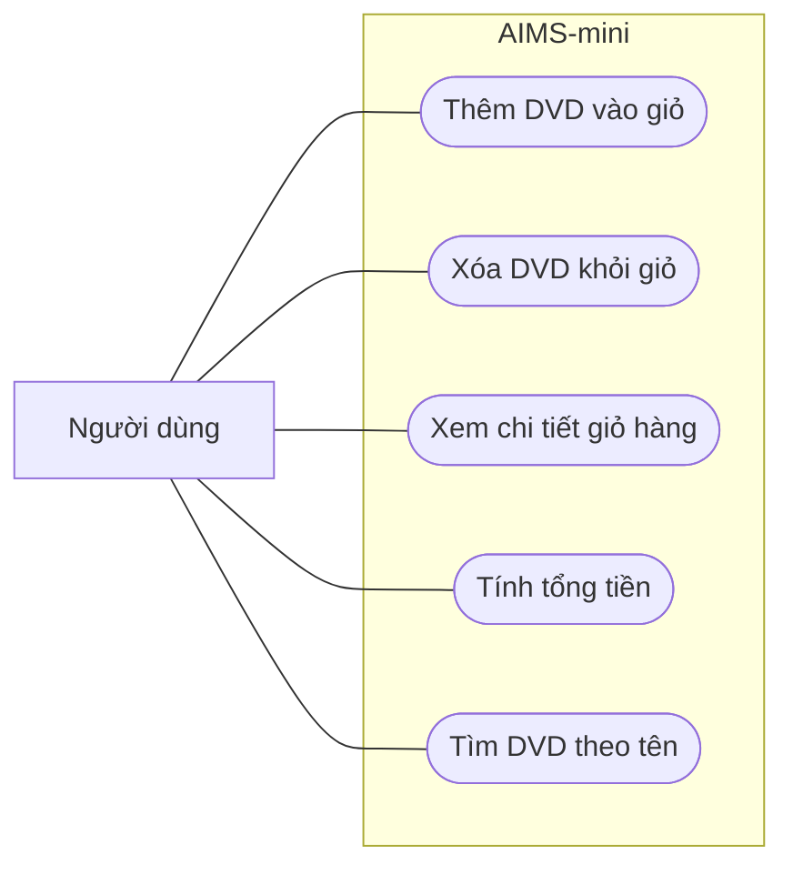

# Use case của AIMS-mini

## Phạm vi và tác nhân

AIMS-mini quản lý giỏ DVD và tìm DVD theo tên. Tác nhân chính là người dùng.
Sơ đồ mô tả các chức năng được mã nguồn hỗ trợ. Hiện `main.py` là chương
trình minh họa với dữ liệu có sẵn, chưa có menu nhập lệnh tương tác.

## Sơ đồ use case

Các hình bầu dục biểu diễn use case, nằm trong ranh giới hệ thống AIMS-mini.
Đường nối thể hiện người dùng tham gia use case tương ứng.

## Mô tả các use case

| Mã | Use case | Hành vi hiện tại | Mã nguồn |
| --- | --- | --- | --- |
| UC01 | Thêm DVD vào giỏ | Thêm DVD khi giỏ có dưới 20 đĩa; nếu đầy, thông báo `The cart is full.` và không thêm. | `Cart.add_dvd(dvd)` |
| UC02 | Xóa DVD khỏi giỏ | Xóa một DVD có trong giỏ; nếu không có, giữ nguyên giỏ. | `Cart.remove_dvd(dvd)` |
| UC03 | Xem chi tiết giỏ hàng | In danh sách DVD và tổng tiền; giỏ trống in `The cart is empty`. | `Cart.print_cart()` |
| UC04 | Tính tổng tiền | Cộng giá các DVD trong giỏ; giỏ trống có tổng bằng 0. | `Cart.total_cost()` |
| UC05 | Tìm DVD theo tên | Trả về các DVD có tên chứa từ khóa; không khớp trả về danh sách rỗng. Hiện phân biệt hoa thường. | `search_by_title(items, keyword)` |

## Luồng chính: xem giỏ hàng

1. Chương trình tạo giỏ và thêm các DVD mẫu.
2. Người dùng chạy `python main.py` để xem chương trình minh họa.
3. Chương trình gọi `cart.print_cart()`.
4. Hệ thống hiển thị số thứ tự, tên, thể loại, đạo diễn, thời lượng và giá DVD.
5. Hệ thống hiển thị tổng tiền. Với dữ liệu mẫu, kết quả là `63.89 $`.

Luồng thay thế: nếu giỏ không có DVD, hệ thống in `The cart is empty` và
kết thúc phương thức.

## Luồng chính: tìm DVD theo tên

1. Bên gọi cung cấp danh sách DVD và từ khóa.
2. Hệ thống kiểm tra từ khóa có nằm trong tên của từng DVD hay không.
3. Hệ thống trả về danh sách các DVD phù hợp.

Ví dụ, từ khóa `Lion` tìm thấy `The Lion King`. Ở phiên bản Lab 02, từ khóa
`lion` không khớp với tên này vì phép tìm kiếm phân biệt hoa thường. Hàm
trả về danh sách rỗng khi không có kết quả hoặc danh sách đầu vào rỗng.
